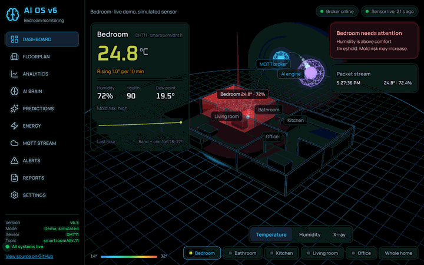
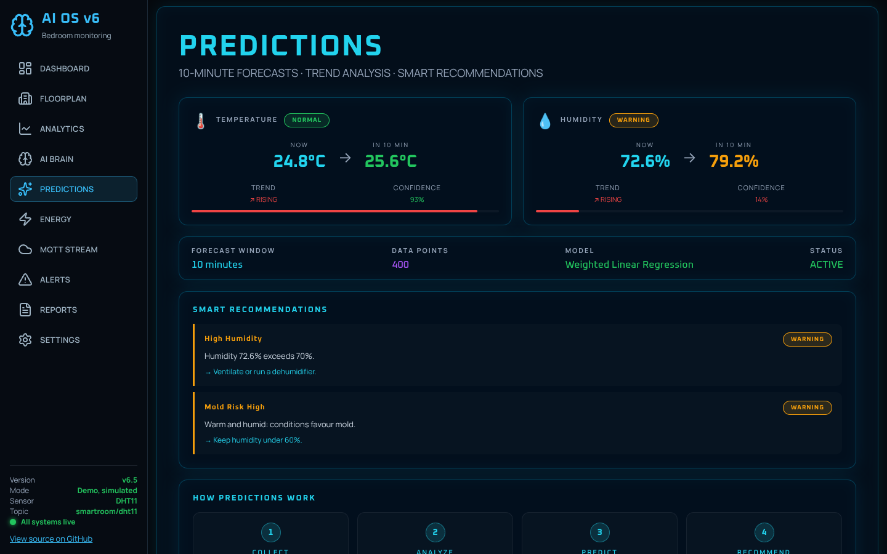
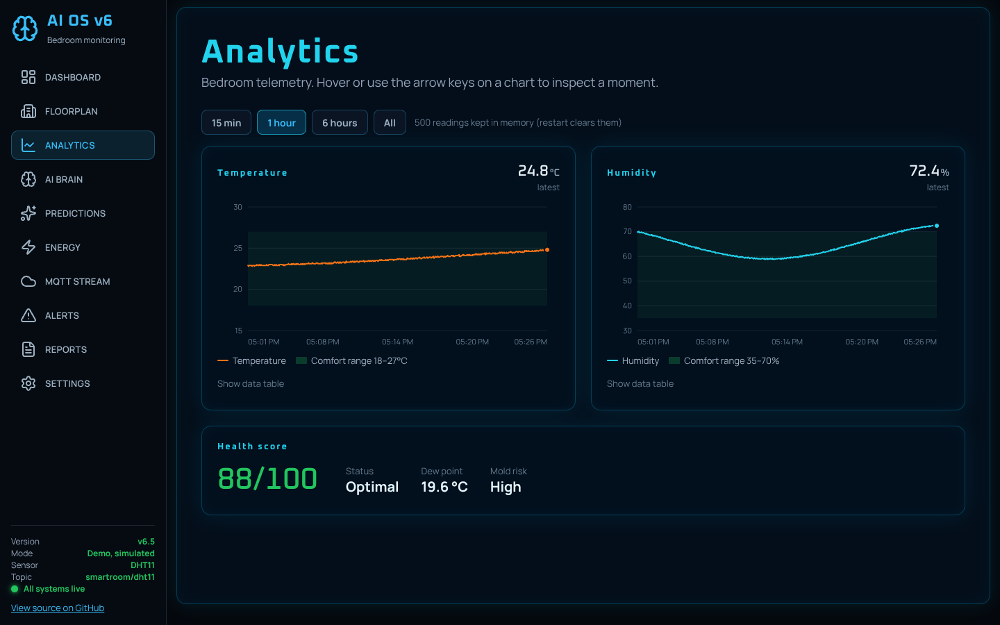
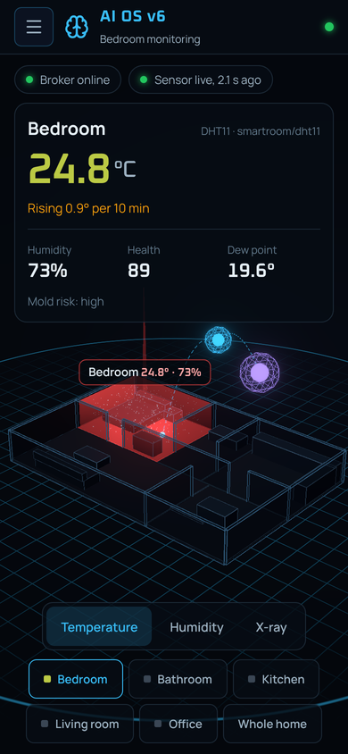

# Smart Building AI Platform

Real-time IoT monitoring for a room. An ESP8266 with a DHT11 sensor publishes temperature and humidity over MQTT. A FastAPI backend validates and stores the readings, computes health, mold risk, short-term forecasts and recommendations. A React dashboard shows it all live as a 3D digital twin, and a Telegram bot keeps you posted.

**[Live demo](https://xarismnt18-bot.github.io/AI-Smart-Building-Platform/)**: the real dashboard with a simulated sensor running in your browser, no install needed.



| Forecasts and recommendations | Telemetry charts | Phone |
|---|---|---|
|  |  |  |

## Architecture

```
ESP8266 + DHT11 ──MQTT──> Mosquitto Broker ──> FastAPI Backend ──> React Dashboard
     sensors               (port 1883)           (port 8000)         (port 5173)
```

## Tech Stack

| Layer | Technology |
|-------|-----------|
| Sensors | ESP8266 + DHT11 (temperature, humidity) |
| Messaging | MQTT via Mosquitto broker |
| Backend | Python, FastAPI, paho-mqtt 2.x |
| Frontend | React, Vite, Three.js via react-three-fiber (3D, bloom), Lucide icons |
| Analytics | numpy (weighted regression), scikit-learn (demo models) |

## Project Structure

```
smart-building-ai/
├── backend/
│   ├── api.py                 # FastAPI app and REST endpoints
│   └── settings_store.py      # Thresholds persisted to data/settings.json
├── ai/
│   ├── mqtt_client.py         # MQTT subscriber: validation, reconnect, stale detection
│   ├── engines/
│   │   ├── prediction_engine.py      # Time-based weighted linear forecasts
│   │   ├── recommendation_engine.py  # Rule-based action suggestions
│   │   ├── comfort.py                # Health score, dew point, mold risk
│   │   └── thresholds.py             # Shared threshold model
│   ├── train_occupancy_model.py      # Demo: occupancy classifier (simulated data)
│   ├── train_anomaly_model.py        # Demo: IsolationForest (simulated data)
│   ├── anomaly_detection.py          # Demo: run both models on simulated data
│   └── live_prediction.py            # Demo: occupancy on simulated data
├── frontend-react/src/
│   ├── App.jsx                # Layout, polling, dashboard pages
│   ├── config.js              # Client settings + backend config helpers
│   ├── hooks/                 # useTelemetry (polling), packet log, media queries
│   └── components/
│       ├── immersive/         # 3D twin scene + HUD (react-three-fiber)
│       ├── pages/             # Dashboard, Analytics, Floorplan, Alerts
│       └── ...                # AIBrain, Energy, Predictions, Reports, Settings
├── sensors/fake_sensor_generator.py  # Writes simulated CO2/power rows to CSV
├── reports/generate_report.py        # Text report over the simulated CSV
├── firmware/esp8266_dht11/   # Sensor sketch (secrets.h is git-ignored)
├── tools/check_secrets.py     # Pre-commit secret scanner
├── setup_security.bat/.ps1    # One-off: MQTT passwords, firewall, network profile
├── config.py                  # Central Python configuration (.env overrides)
├── main.py                    # Backend entry point
├── Run_AIOS_v6.bat            # Launch broker, backend, frontend (Windows)
└── requirements.txt
```

## Quick Start

### Prerequisites
- Python 3.11+
- Node.js 18+
- Mosquitto MQTT broker
- ESP8266 + DHT11 sensor

### 1. Install

```bash
pip install -r requirements.txt
cd frontend-react && npm install
```

### 2. Configure

Copy `.env.example` to `.env` and set your broker IP:

```env
MQTT_BROKER=192.168.1.100
MQTT_TOPIC=smartroom/dht11
```

The sensor should publish JSON like `{"room": "Bedroom", "temperature": 23.4, "humidity": 51}`.

### 3. Run

**Windows:** double-click `Run_AIOS_v6.bat` (works from any folder location).

**Start automatically:** run `install_autostart.bat` once. AIOS then starts hidden every time you sign in to Windows (logs in `logs/`), and an **AIOS Dashboard** shortcut appears on the desktop. `uninstall_autostart.bat` undoes it. `restart_aios.bat` restarts it in the background (e.g. after `setup_telegram.bat`).

**Manually:**
```bash
mosquitto                 # terminal 1
python main.py --reload   # terminal 2 (drop --reload in normal use)
cd frontend-react && npm run dev   # terminal 3
```

Open http://localhost:5173. The backend keeps retrying the broker, so start order doesn't matter.

## Connection status

The dashboard separates three states:

- **API offline**: the dashboard can't reach FastAPI.
- **Broker offline**: FastAPI can't reach Mosquitto (it retries every 1–30 s).
- **Sensor offline**: the broker is up but no valid packet arrived for `SENSOR_STALE_SEC` (default 30 s).

Malformed or out-of-range packets are ignored and counted (`invalid_packets`); they don't mark the system offline.

## Dashboard Pages

| Page | Description |
|------|------------|
| **Dashboard** | Full-screen live 3D twin of the home with a HUD: readings, trend, alerts, packet stream. Views: temperature, humidity, X-ray. Click a room to fly to it. The live room turns red and pulses on any alert, and grey when there is no data |
| **Floorplan** | 2D room status overview |
| **Analytics** | Temperature and humidity trend charts |
| **AI Brain** | Rule-based comfort analysis and deviation check |
| **Predictions** | 10-minute forecasts with fit-based confidence |
| **Energy** | **Simulated** power estimate (no power meter connected) |
| **MQTT Stream** | Live packet monitor |
| **Alerts** | Alerts from the backend, dew point and mold risk |
| **Reports** | Summary statistics, distribution charts, CSV export |
| **Settings** | Thresholds (saved in backend), dashboard preferences |

## API Endpoints

| Endpoint | Method | Description |
|----------|--------|-------------|
| `/` | GET | API, broker and sensor status |
| `/latest` | GET | Latest reading + connection state |
| `/history?limit=N` | GET | Telemetry history (in memory, last `HISTORY_MAX_SIZE`) |
| `/health` | GET | Health score, dew point, mold risk |
| `/alerts` | GET | Active alerts |
| `/predictions` | GET | Forecasts for temperature and humidity |
| `/recommendations` | GET | Suggested actions |
| `/config` | GET / PUT / DELETE | Read, update (partial JSON) or reset thresholds |
| `/notifications` | GET | Whether Telegram alerts are set up, and until when they are muted |
| `/notifications/test` | POST | Send a test message to Telegram |
| `/voice/test` | POST | Make the Echo speak a test sentence |
| `/voice/status` | GET | The sentence Alexa reads for "Alexa, bedroom status" |

## How predictions work

Weighted linear regression over the last `PREDICTION_LOOKBACK_MIN` minutes, fitted against real timestamps, so the horizon is correct whatever the sensor's send rate. Confidence comes from the weighted residual spread, widened by how far the forecast extrapolates beyond the observed window.

## Configuration

Set in `.env` (see `config.py` for the full list):

| Variable | Default | Description |
|----------|---------|-------------|
| `MQTT_BROKER` | `127.0.0.1` | Broker address as seen by the backend |
| `MQTT_PORT` | `1883` | MQTT broker port |
| `MQTT_TOPIC` | `smartroom/dht11` | Sensor topic |
| `SENSOR_STALE_SEC` | `30` | Seconds without packets before the sensor counts as offline |
| `DISCOVERY_ENABLED` / `DISCOVERY_PORT` | `true` / `18831` | Broadcast the broker's address so the ESP8266 finds it |
| `NOTIFY_COOLDOWN_MIN` | `30` | Minimum minutes between two messages for the same alert |
| `DAILY_SUMMARY_TIME` | `09:00` | When the morning summary is sent (local time) |
| `VOICE_QUIET_HOURS` | `23:00-08:00` | Alexa stays silent in this window |
| `VOICE_STATUS_VAR` | `AIOS_STATUS` | Voice Monkey variable holding the status sentence |
| `VOICE_STATUS_SEC` | `60` | How often the status sentence is checked for changes |
| `API_RELOAD` | `false` | Auto-reload backend on code changes |
| `TEMP_HIGH` / `TEMP_LOW` | `27` / `18` | Initial temperature thresholds (°C) |
| `HUMIDITY_HIGH` / `HUMIDITY_LOW` | `70` / `35` | Initial humidity thresholds (%) |

Thresholds changed from the Settings page are saved by the backend to `data/settings.json` and override the `.env` values. **Reset to defaults** deletes that file.

## ESP8266 firmware

The sensor sketch lives in `firmware/esp8266_dht11/`. Copy `secrets.example.h` to `secrets.h` (git-ignored), set your Wi-Fi, the broker PC's LAN IP and the MQTT login, then upload with the Arduino IDE (board: NodeMCU 1.0). Libraries: PubSubClient, DHT sensor library.

**The board finds the PC by itself.** The backend broadcasts `AIOS-BROKER v1 port=1883` on UDP 18831 every 3 s. The ESP8266 listens and connects to whichever PC sent it, so a new IP on the PC (another Wi-Fi, a DHCP change) doesn't break the sensor. `MQTT_SERVER` in `secrets.h` is just the first guess at boot.

## Telegram alerts

Run `setup_telegram.bat` and follow the prompts: create a bot with @BotFather, paste its token, press Start in the bot chat. The script stores the token and your chat id in `telegram.env` (git-ignored) and sends a test message. After a restart, the backend messages you when an alert starts or clears and when the sensor stops sending. A change must hold for two checks (~30 s) before it is reported, and the same alert repeats at most every `NOTIFY_COOLDOWN_MIN` minutes. Settings has a **Send test message** button.

The bot also answers commands (only from your chat):

| Command | Reply |
|---------|-------|
| `/status` | Current readings, health, 10-minute forecast and active alerts |
| `/today`, `/night` | Today's min / max / average and time spent out of range |
| `/mute 2h` | Pause alert messages (`30m`, `2h`, `1d`; default 1 hour) |
| `/unmute` | Resume alert messages |

Every morning at `DAILY_SUMMARY_TIME` (09:00) it sends yesterday's summary: temperature and humidity range, and how long each limit was crossed. The day's totals are kept in `data/daily_stats.json`, so a restart doesn't lose them.

## Alert lamp (IKEA smart plug)

A lamp on an IKEA smart plug lights up while a temperature or humidity alert is active and switches off when it clears (it stays on at least 10 minutes so a reading hovering at the limit can't make it flicker, and stays dark during `LAMP_QUIET_HOURS`, 23:00-08:00). AIOS talks to the IKEA DIRIGERA hub over its local API: no cloud and no request quota. With the plug already working in the IKEA Home smart app, run `setup_ikea.bat` and press the action button under the hub when asked; it finds the hub, stores a token in `ikea.env` (git-ignored), flashes the lamp once and restarts AIOS. Telegram: `/lamp on`, `/lamp off` (during an alert, keeps it off until the alert clears), `/lamp auto on|off`. API: `GET /lamp`, `POST /lamp?on=true`.

## History

The backend stores the live reading every 30 seconds in `data/history.db` (SQLite, git-ignored) and keeps 30 days; nothing is stored while the sensor is offline, so gaps show when it was off. Telegram `/night` lists the last 10 hours hour by hour (`/night 24` for a day), flagging hours that crossed a limit. API: `GET /history/range?hours=12&step=300` (averages for charts) and `GET /history.csv?hours=24` (every reading, as a download; from the phone via Tailscale at `https://<pc>.ts.net/api/history.csv?hours=12`).

## Tests

Backend unit tests (alerts, notifications, voice budget, Alexa status, alert lamp, Telegram commands, API) run without a broker or any account:

```
venv\Scripts\pip install -r requirements-dev.txt
venv\Scripts\python -m pytest
```

## Remote access (Tailscale)

The dashboard can be opened from your phone anywhere, without opening ports on the router. Install [Tailscale](https://tailscale.com/download) on the PC and on the phone and sign in with the same account, then run `setup_remote.bat`. It publishes the dashboard with `tailscale serve` at `https://<pc-name>.<tailnet>.ts.net/` (HTTPS, reachable only from your own Tailscale devices) and copies the link. The setting survives restarts; `tailscale serve reset` turns it off. The backend stays bound to 127.0.0.1: the dashboard reaches it through the Vite proxy at `/api`.

## Laptop as the server

AIOS stops while the PC sleeps or hibernates (no alerts, no remote dashboard, and Alexa keeps the last reading). `keep_awake.bat` (asks for admin) sets the plugged-in power plan so the laptop never sleeps, closing the lid does nothing and the screen turns off after 2 minutes; battery settings are unchanged. Undo it in Settings > System > Power.

## Spoken alerts (Alexa)

New alerts can also be announced on an Amazon Echo through [Voice Monkey](https://voicemonkey.io). Sign in there, enable the Voice Monkey skill in the Alexa app, add your Echo as a Speaker device, and in the Alexa app create a Routine (When: Smart Home → Alexa Voice Monkey v3 → VM Speakers → your speaker; Action: the Voice Monkey skill; From: your Echo). Then run `setup_voice.bat` and paste the API token; it stores it in `voice.env` (git-ignored) and makes the Echo say hello. Only new alerts are spoken, never "back to normal", the same alert at most once every 6 hours and at most 5 a day (each announcement is a Voice Monkey request; the free plan allows 200 a month), never during `VOICE_QUIET_HOURS` (23:00-08:00) and never while `/mute` is on. From Telegram: `/voice off`, `/voice on`, `/voice test`. Alexa speaks English only, so the announcements are in English.

**Ask Alexa for the room status** (needs a paid Voice Monkey plan, see below). While AIOS runs it keeps a sentence such as *"The bedroom is 24 degrees, with 85 percent humidity. That is above your limit of 70 percent."* in the Voice Monkey variable `AIOS_STATUS` (updated when it changes; set to "server is switched off" on shutdown). In the Voice Monkey console create a Flow with one Speech node whose text is `{AIOS_STATUS}` on your Echo and note its 4-digit reference. In the Alexa app create a Routine: When you say *"bedroom status"*, Action Custom *"ask voice monkey to start flow <reference>"*, From your Echo. Then say *"Alexa, bedroom status"*. `/voice status` in Telegram makes the Echo read it too. Nothing on the PC is exposed to the internet. Each update is one Voice Monkey request and the free plan allows only 200 a month, so updates are off unless `VOICE_STATUS_ENABLED=1` is set (Hobby plan or above); while off, Alexa says the status is paused and points to Telegram `/status`.

## Live demo build

`VITE_DEMO=1 npm run build` builds the dashboard with an in-browser stand-in for the backend (`src/lib/demoApi.js`, same formulas as the Python engines). `publish_demo.bat` builds it this way and pushes it to the `gh-pages` branch, which GitHub Pages serves. Run it again to refresh the online demo.

## Security

- **MQTT login.** Run `setup_security.bat` once (it asks for admin). It creates random passwords for `backend` and `esp8266`, turns off anonymous access in Mosquitto, and writes the logins to git-ignored files (`mqtt_credentials.env`, `firmware/.../secrets.h`). It also sets the home Wi-Fi to *Private* and limits the Mosquitto firewall rule to private networks, so the broker isn't exposed on public Wi-Fi.
- **API is local-only.** The API has no login, so it listens on `127.0.0.1` and accepts browser calls only from the local dashboard (`CORS_ORIGINS`).
- **No secrets in git.** `.env`, `mqtt_credentials.env`, `telegram.env`, `voice.env`, `secrets.h`, `*.pkl` and data files are ignored. `tools/check_secrets.py` runs as a pre-commit hook and blocks commits that stage credentials or keys.
- **Model files.** `.pkl` files can execute code when loaded, so they are not versioned; retrain locally with the scripts below instead of loading pickles from elsewhere.
- **Discovery beacon.** Any device on the LAN could fake the beacon and make the ESP8266 try to log in to it. That needs someone already on your Wi-Fi; on a network you don't trust, set `DISCOVERY_ENABLED=false` and use a fixed `MQTT_SERVER`.
- MQTT traffic on the LAN is not encrypted (the ESP8266 is too small for comfortable TLS); the password login stops other devices from reading or injecting data.

## Demo ML scripts

The scripts in `ai/` that use CO2 and power run on **simulated** data from `sensors/fake_sensor_generator.py`, because the DHT11 doesn't measure either. The occupancy labels are rule-derived (see `train_occupancy_model.py`), so these are pipeline demos, not validated models. The backend doesn't use them.

```bash
python sensors/fake_sensor_generator.py   # collect simulated rows (Ctrl+C)
python ai/train_occupancy_model.py
python ai/train_anomaly_model.py
python ai/anomaly_detection.py
```

## License

MIT
